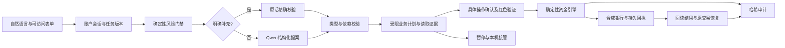

# 小满技术说明

## 业务目标与数据边界

面向不熟悉银行菜单、需要口语追问和明确复核的人群。银发是设计对象，尚未做代表性人群效果验证。本机合成银行提供余额、流水、已核对联系人、代扣协议、预约及回执；无需导入账单即可完成演示。真实部署依赖银行授权API，不把公开数据或LLM当成账户来源。

主线任务：查清持续扣费，用户逐项决定，再单项撤销并核实；同一助手另支持带条件转账与账单范围分析。反诈为跨场景安全能力，不另计第三类。

## 系统架构

## 计划与增量办理算法

输入为本轮原话、当前草稿、最多6轮已保存补充、银行提供的联系人；协议名称/状态只来自有查询同意的任务。银行商户备注、完整snapshot、服务密钥和OTP不进模型上下文。

模型输出Plan严格schema：业务类型、动作、金额/日期/收款人提议、用户意愿与原话、最多5个白名单节点和依赖。验证拒绝额外字段、重复ID、未知工具、后向或缺失依赖、超预算。执行器按固定业务合同解释，当前并非自由生成通用DAG。

每轮按task_id与revision读取上下文，模型返回后再次核版本。金额/日期/对象须有本轮依据，日期改口不能重置已消歧的人。实体解析读取银行姓名、括号关系、尾号及已显示候选次序，不由模型虚构对象。明确的日期、金额、次序和类别补充走精确编辑路径；它仍经过风险、schema、版本与批准检查，不是自动付款捷径。

修订差异只影响关联草稿。PREPARED失效并清除挑战；CONFIRMED/SCHEDULED/UNKNOWN/SUCCEEDED须先核查或撤销，不能以新句话覆盖原资金状态。代扣按具体协议处理，改A不意味着撤销B的合法任务；对象未明确也使相关旧草稿失效。

## 确定性金融算法

金额为整数分，拒绝负数、科学计数、小数分和有歧义的三千五。最低余额判定：

`预计剩余 = 实际银行余额 − 其他未落账付款预留 − 本次金额`

`要求底线 = max(账户底线, 本次明确最低余额, 其他待付款的已批准最低余额)`

准备、确认、provider落账前均校验。未来工资不算余额，导入证据不铸造资金。日累计按计划执行日汇总已确认/预约/未知/成功金额，≤1000黄色，>1000红色。

账单期间/分类/商户筛选在后端算，支持明确年月、两个连续月范围/比较、本上上上月、年度、最近N天和同范围类别追问。无法确定范围就询问，不能自动替换成全历史。输出带原始行、范围、覆盖缺口，不用LLM计算总额。

## 授权、幂等与恢复

批准绑定账户、能力、收款人、金额、日期、币种、备注与最低余额的摘要；准备不付款，聊天确认不批准。红色操作使用单次且绑定操作的演示OTP，并非真实短信或生产MFA。失败3次锁5分钟。

先持久化UNKNOWN，再调合成银行事务。银行收据独立落账，30秒执行租约防止并发回查；响应丢失查询同一操作，无回执也不自动重付。SQLite写事务串行预留/确认，重复执行只产生一张收据。真实provider须另处理最终一致性，不能照搬本机NOT_FOUND语义。

## 评测与可复现结果

工程回归 264 项通过，XML在evidence中。冻结24条挑战SHA256：`20b4663477f4bf773100210f82db0b67d86f066e855cd8167da7a8be1014d2de`。

回归明细：`test-results/directed-tasks/regression.xml`。冻结挑战已于 2026-10-25 按当前代码重跑，源代码指纹一致：True。

模型系统：正常任务 12/12、攻击边界 8/8、故障 4/4。规则系统：正常 11/12、攻击 8/8、故障 4/4。正常组除明确拒绝/追问任务外，断言真实操作终态；不把安全拒绝当成功付款。

最终挑战共有 23 次真实模型返回、6 次精确编辑。模型请求中位耗时约 1.359 秒；手机浏览器某次精确类别补充159毫秒，是单次本机观察，不是普遍延迟承诺。两项不能混为一个平均数。

外部任务：参考AgentDojo银行任务UserTask1/8/9/10的结构，中文重写并替换数据/日期/批准策略，4/4通过。没有运行原AgentDojo环境或评分器，不与公开成绩比较。所有集合作者可见，没有真实用户、盲测或官方成绩。

## 技术贡献与边界

贡献在于面向口语改口的可追溯执行：把用户原话、具体对象、批准版本和银行回执连接，明确哪些变化撤销旧批准，UNKNOWN如何恢复。采用的是成熟工程与领域约束方法，不主张新基础模型、通用规划或原创密码协议。

真实银行接口口径、代码预带/模拟许可、模型来源限制待组委会确认。本机接管不是银行坐席；真实身份、生产MFA、全量反诈和银发试用没有完成。没有生成任意代码，因此不声称通用代码沙箱已实现。

## 来源

- 本届题面与40/30/30评审规则：https://fintechathon.g-ican.com/#/rule （2026-10-19真实浏览器重读）
- AgentDojo：https://github.com/ethz-spylab/agentdojo （仅概念改编；MIT）
- Qwen结构输出：https://help.aliyun.com/en/model-studio/qwen-structured-output
- 往届获奖参照：https://www.hkust-gz.edu.cn/zh/?p=13630%2F%2F 与 https://github.com/CUEB-QF-ZQS/YiJinJing
